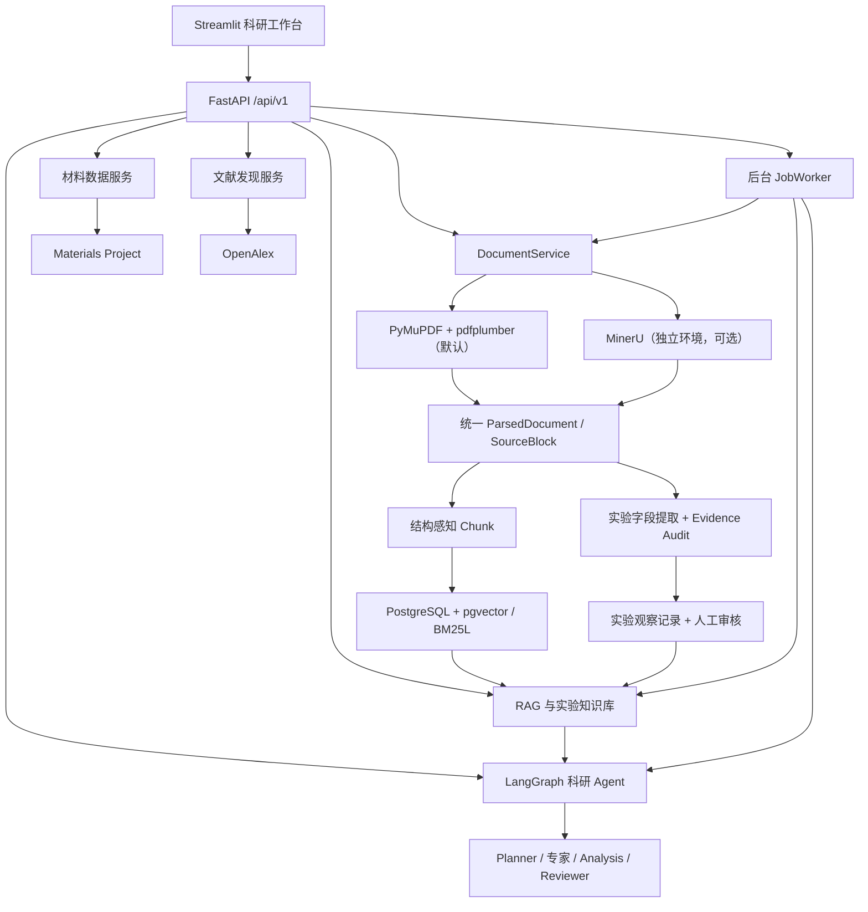
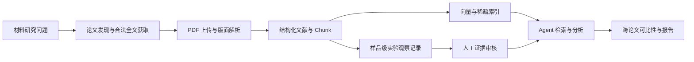

# MatPilot

### 面向材料科学研究的循证 AI Agent 工作台

**MatPilot** 是一个聚焦半导体与光电材料的 AI for Science 应用项目，以**跨论文实验知识提取与对比分析**为核心场景，连接材料计算数据、科研论文、实验记录与多 Agent 分析流程。

项目希望解决实际科研工作中的三个问题：不同论文的实验数据分散且难以比较；复杂 PDF 的版面和表格影响信息提取；大模型给出的科研结论需要有可复核的来源。

MatPilot 将 **PDF 结构化解析 → 实验观察记录 → 语义检索 → 跨论文比较 → 人工证据审核**组织在统一工作流中。计算数据与实验数据分别标注，缺失字段保持缺失，任何跨样品或跨论文的比较都必须考虑测量方法与实验条件。

> **项目阶段：V0.9 + V0.10 开发分支。** 已实现主要模块并通过离线自动化检查；MinerU 本地 GPU → FastAPI → PostgreSQL → 检索与人工审核的完整联调仍需在真实运行环境验收。项目是科研辅助工具，不自动认定实验因果关系或替代科研人员判断。

---

## 01 · 产品定位与核心场景

MatPilot 面向材料科研中从文献调研到实验对比的常见任务，当前重点关注**实验光学带隙**（Optical Band Gap）的结构化整理与证据关联。

一个典型研究问题是：

> 不同退火温度、掺杂方式和表征方法下，TiO₂ 等材料的实验光学带隙如何变化？论文之间的结果能否直接比较？

平台将研究问题拆为可执行的步骤：导入具有合法使用权限的论文；解析标题、章节和实验段落；识别样品、材料、工艺、测量方法与数值；保留原文证据；由规则与 Agent 协助比较；最后交由研究者确认。

**设计约束**

- **实验值与计算值分离**：Materials Project 计算属性不自动充当实验测量值。
- **样品级证据**：每条候选结果关联文献、样品标识、页码、原文块和摘录。
- **缺失不补造**：未报告的晶相、掺杂量或测试条件保留为空或待核查。
- **可比性先于推论**：不同晶相、实验方法或条件可能导致结果不可直接比较。
- **人类最终审核**：模型辅助提取与 Reviewer 不等于独立科研鉴定。

## 02 · 核心功能

| 工作区 | 实现能力 | 说明 |
| --- | --- | --- |
| **材料筛选** | 化学式、元素、带隙与稳定性检索，材料详情及结构展示 | 来源为 Materials Project 的计算数据 |
| **论文发现** | 关键词/DOI 检索、开放获取与元数据查看 | OpenAlex 元数据不等于已获取论文全文 |
| **论文解析** | 上传 PDF、逐页查看、标题/章节/表格识别、可选 MinerU 重解析 | 保留原始 PDF、页码、坐标与来源块 |
| **文献知识库** | Dense、BM25L、RRF 混合检索、可选 Rerank、引用式问答 | PostgreSQL + pgvector |
| **实验知识库** | 样品级实验光学带隙提取、条件关联、审核、跨论文对比与导出 | 机器记录默认需人工审核 |
| **科研助手** | 单 Agent、自动路由、多角色协作、任务记录与 Reviewer | LangGraph 编排，有界工具调用 |

当前实验知识库的结构化物性范围主要是 **实验光学带隙（eV）**。光电流、响应度、电阻率、迁移率等更广泛物性尚未形成通用结构化提取链路。

## 03 · 系统架构



| 层次 | 技术栈 |
| --- | --- |
| Python 与依赖管理 | Python 3.13、uv、uv.lock |
| API / 界面 | FastAPI、Pydantic、Streamlit |
| Agent 编排 | LangGraph、限制工具白名单的协作工作流 |
| 论文解析 | PyMuPDF、pdfplumber；可选 MinerU 4.x 独立进程 |
| 向量 / 稀疏检索 | text-embedding-v4、pgvector、BM25L、Jieba、RRF、可选 Rerank |
| 模型服务 | DashScope 兼容接口（默认 qwen-plus） |
| 数据库 | PostgreSQL 17 + pgvector，实验记录使用 JSONB |
| 工程质量 | pytest、Ruff、Alembic、GitHub Actions |

详细 Agent 编排参见 [多角色科研协作](docs/collaboration.md) 和 [项目架构](docs/architecture.md)。

## 04 · V0.10 PDF 解析与 RAG 升级

### V0.10.1 · 双解析引擎与统一文档模型

默认的 **PyMuPDF** 负责快速读取文本 PDF，结合 pdfplumber 处理表格，并执行全角字符规范化、期刊页眉过滤、标题识别和基础阅读顺序修复。

对于双栏、复杂版面、公式密集或扫描文档，可选择**独立 MinerU 进程**执行高精度解析。MinerU 不加入 MatPilot Python 3.13 的主依赖，降低 GPU 环境与服务依赖之间的耦合。

两个引擎统一输出 `ParsedDocument` / `SourceBlock`，包括：

- `document_id`、`parser_engine`、`parent_document_id`（重解析版本关系）
- `page_number`、`bbox`、`block_id`（定位来源）
- `role`、`section_title`、`section_path`（标题、正文、章节、表格、公式或图注）

MinerU 重解析会**创建新文献版本**，不覆盖旧 PDF、已经审核的实验记录或已有索引。OCR 文本仍需回到 PDF 原页复核；缺失或不可靠的坐标不会自动编造。

### V0.10.2 · 结构感知 Chunk

Chunk 不再仅依赖固定字符长度，而是结合**章节、页面、段落和表格**组织：

- 同一页面、同一章节内的相邻段落可组合为检索单元。
- 长文本优先沿段落或句子边界切分。
- 表格保留整体内容、表头与数据行。
- `section_path` 和 `source_block_ids` 写入向量索引，以便定位原文。
- 内嵌 Base64 图片不进入文本 Embedding。

当前实现着重保证来源可追溯。跨页实验语义关联、独立图像存储与图文多模态检索仍属于后续优化方向。

### V0.10.3 · Agent、检索和证据审核联动

文献 Chunk 通过 **Dense + BM25L + RRF** 检索，并可按需启用重排。科研助手接收来源段落、章节和页码等上下文，程序进一步验证模型引用是否确实存在于对应的原始解析块中。

实验知识库中的结构化候选记录还会校验：

1. 文献与来源块是否对应；
2. 页码与原文摘录是否匹配；
3. 提取的光学带隙数值能否在证据文本中找到；
4. 推导出的样品标识或实验条件是否被标记为需人工审核。

人工审核记录与导出结果保留来源。上述检查验证的是**解析文本内的引用一致性**，不等于 OCR 绝对准确或科研结论正确。

进一步的配置、数据迁移及验收约束见 [MinerU 集成说明](docs/v0.10/mineru-integration.md)。

## 05 · 快速开始（Windows / PowerShell）

### 5.1 环境准备

推荐安装：

- Git、Python **3.13**、[uv](https://docs.astral.sh/uv/)
- Docker Desktop（用于 PostgreSQL + pgvector）
- 需要调用对应功能时配置 Materials Project 与 DashScope API Key
- 可选：独立 MinerU 环境（详见下一节）

```powershell
git clone https://github.com/ivyfan-toowell/mat_pilot.git
cd mat_pilot

# 安装后端、数据库和 Streamlit 依赖
uv sync --locked --all-extras

# 首次创建本地配置；已有 .env 时不会覆盖
if (-not (Test-Path .env)) { Copy-Item .env.example .env }
```

> 注意：截至本 README 更新，V0.9/V0.10 修改位于 `feature/v0.9-research-analysis` / PR #2。若尚未合并到 `main`，请在首次克隆后执行 `git switch feature/v0.9-research-analysis`（必要时先 `git fetch origin`），再运行 `uv sync`。

### 5.2 配置 .env

在根目录的 `.env` 中填写密钥与连接参数。不要把真实密钥提交到 GitHub。

| 配置 | 用途 |
| --- | --- |
| `MP_API_KEY` | Materials Project 数据 |
| `DASHSCOPE_API_KEY` | LLM、Embedding 与可选 Rerank |
| `OPENALEX_API_KEY` | 论文发现（可选） |
| `DATABASE_URL` / `POSTGRES_*` | PostgreSQL 连接 |
| `LLM_MODEL` | 默认 `qwen-plus` |
| `EMBEDDING_MODEL` / `EMBEDDING_DIMENSIONS` | 默认 `text-embedding-v4` / 1024 |
| `AUTH_MODE` / `AUTH_API_KEYS` | 本机或 API Key 租户模式 |
| `SCHEMA_AUTO_APPLY` | 启动时自动补充数据库表结构 |
| `MINERU_CLI_PATH` | 可选 MinerU 可执行程序路径 |
| `MINERU_TIMEOUT_SECONDS` | 可选解析超时（秒） |

全部变量见 [配置模板](.env.example)。

### 5.3 启动 PostgreSQL 并迁移

先启动 Docker Desktop，再在项目根目录执行：

```powershell
uv run --locked --all-extras python -m scripts.setup_database
docker compose up -d --wait db

# 首次部署或升级既有数据库，执行幂等迁移
uv run --locked --all-extras alembic upgrade head
```

Compose 当前**只运行数据库**，默认对本机开放 `127.0.0.1:5433`。升级前建议备份既有 PostgreSQL 数据卷；不要为解决连接问题直接删除数据卷。

### 5.4 分别运行后端与前端

**Terminal 1 — FastAPI（8000）**

```powershell
uv run --locked --all-extras uvicorn app.main:app --host 127.0.0.1 --port 8000
```

**Terminal 2 — Streamlit（8501）**

```powershell
uv run --locked --all-extras streamlit run streamlit_app.py --server.address 127.0.0.1 --server.port 8501
```

| 入口 | 地址 |
| --- | --- |
| 工作台 | http://127.0.0.1:8501 |
| FastAPI Swagger | http://127.0.0.1:8000/docs |
| 服务状态 | http://127.0.0.1:8000/health |
| 数据库与配置就绪 | http://127.0.0.1:8000/health/ready |

`/health/ready` 只检查配置与数据库状态，不代表付费模型调用和真实 PDF 解析已经验收。

### 5.5 配置可选 MinerU

MinerU 安装在**独立环境**，而不是 MatPilot 主项目的 `.venv` 中。在 `.env` 中设置，例如：

```dotenv
MINERU_CLI_PATH=E:/AI Learning/matpilot_parser_benchmark/.venv/Scripts/mineru-kit.exe
MINERU_TIMEOUT_SECONDS=1800
```

这只是路径示例，必须指向本机实际存在的 `mineru-kit.exe`。修改后重新启动后端。

进入「论文解析」→ 选择已上传文献 →「解析质量优化 · MinerU 高精度解析」→「使用 MinerU 重新解析所选论文」。该操作走后台任务；新的文献 UUID 需要单独建索引、提取实验记录并审核。

当前适配器主要读取 MinerU ZIP 中的结构化 JSON。**真实 GPU 环境中能否完全兼容安装的 MinerU 版本，仍需联调确认。** 仅导出 Markdown 不能保证保留原文页码与坐标。

## 06 · 推荐使用流程



**推荐流程**：材料筛选 → 论文发现 → 上传 PDF → 核对标题/章节/表格 → 根据需要用 MinerU 重解析 → 为最终选定的文献版本建立索引 → 实验知识提取 → 原文审核 → 跨论文比较与科研问答。

平台支持按文献名称选择已经解析的论文，普通使用者无需手动复制 UUID。对于同一论文的不同解析版本，应选用对应的文献记录，不要混用旧版证据。

### 研究样例与验证边界

项目曾以两篇中文论文进行小规模人工核对：

- **氮气退火 TiO₂ 薄膜**：原文包含 500、600、700、800、900℃ 对应的 3.98、3.97、3.96、3.73、3.30 eV 实验数据；此前专门的中文序列提取逻辑曾成功存入 5 条待审核记录。
- **CsPbBr₃/VO₂ 异质结构**：原文包含根据 PL 峰约 540 nm 估算的 CsPbBr₃ 带隙约 2.3 eV；此前专门的中文 PL 提取逻辑曾成功存入 1 条待审核记录。

这些案例证明了有限场景可运行，**不能据此声称通用中文论文提取准确率、跨论文推理准确率或 MinerU 集成端到端完成验收**。

如需可公开获取的英文样例，可运行：

```powershell
uv run --locked --all-extras python -m scripts.download_sample_paper
```

样例 PMCID 为 `PMC7153365`，DOI 为 `10.3390/nano10030546`。论文的许可、来源和具体使用范围仍需遵循原始文档声明。

## 07 · 数据、审计与安全设计

- **文献 SSOT**：已解析文献存储在 PostgreSQL `mp_docs`，原始 PDF 留在租户目录。
- **知识索引**：`mp_documents`、`mp_chunks`；Chunk 记录页码、来源块 ID 及章节路径。
- **实验知识**：`mp_knowledge_runs`、`mp_knowledge_observations`、`mp_knowledge_reviews` 分别保存提取任务、候选记录与审核历史。
- **隔离与认证**：默认单机 `local` 租户；共享环境应设置 `AUTH_MODE=api_key`。
- **长任务**：进程内 JobWorker 与状态落盘；当前不具备跨进程分布式任务队列的完整容灾能力。
- **模型成本**：Embedding、LLM、Rerank 和部分结构化提取会触发外部服务调用。
- **可追溯性**：同一论文的不同解析版本有不同文献 ID，已有人工审核记录不会自动迁移或覆盖。

文件目录与核心代码：

```text
mat_pilot/
├── app/
│   ├── agents/                   # LangGraph、专家协作、Reviewer
│   ├── api/                      # FastAPI /api/v1
│   ├── core/                     # 配置、租户、认证、日志
│   ├── ingestion/                # PyMuPDF、MinerU、Chunk、实验提取
│   ├── schemas/                  # 统一文档与科研证据模型
│   ├── science/                  # 材料科学数据适配
│   └── services/                 # RAG、数据库、审核与业务服务
├── ui/                           # Streamlit 六个工作区
├── alembic/                      # 数据库迁移
├── scripts/                      # 数据库与样例脚本
├── tests/                        # 自动化测试
├── docs/                         # 设计、架构、使用与局限
├── streamlit_app.py              # 前端入口
├── docker-compose.yml
├── .env.example
├── pyproject.toml
└── uv.lock
```

## 08 · 开发、测试与已知限制

```powershell
uv run --locked --all-extras pytest -q
uv run --locked --all-extras ruff check .
uv lock --check
```

截至本轮 V0.10 代码提交，GitHub Actions 最近一次确认 **205 项离线测试通过，Ruff 通过**。这些测试主要验证服务逻辑、数据模型、合成解析数据和安全边界，不等于真实材料科学数据集的统计评测。

[查看 GitHub Actions 验证记录](https://github.com/ivyfan-toowell/mat_pilot/actions/runs/42624085581)

目前仍需继续验证和建设：真实 MinerU 结构化 ZIP 与本机环境兼容性、端到端证据定位、独立论文标注集、复杂表格/图像理解、科研物性范围扩展，以及大规模部署下的任务可靠性。

## 09 · 相关文档

- [项目架构](docs/architecture.md) · [多 Agent 协作](docs/collaboration.md)
- [V0.9 实验知识库使用](docs/v0.9/usage.md) · [科研局限](docs/v0.9/limitations.md)
- [V0.10 MinerU / Chunk / 证据联动](docs/v0.10/mineru-integration.md)
- [检索与评测](docs/retrieval.md) · [API 文档](docs/api.md)
- [GitHub 维护说明](docs/github.md)

---

**MatPilot · Evidence-backed Research Agents for Materials Science**

*让每条实验数据有来源，让每项跨论文比较有条件，让每个科研结论都能被审查。*
