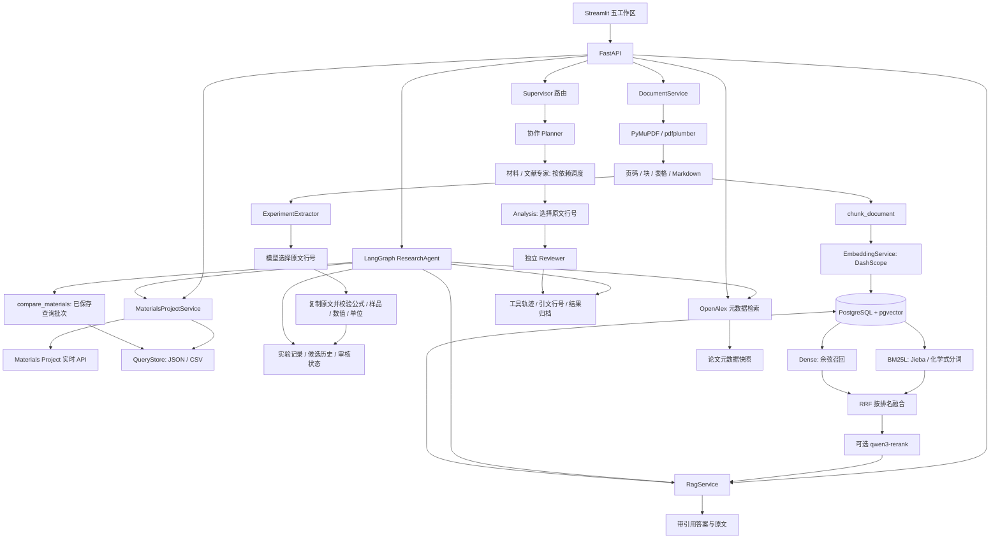

# 当前架构与调用关系

主要函数与边界：

- MaterialsProjectService.search/get_details/get_structure 共用真实 SDK，返回来源与单位。
- DocumentService.ingest 保留原始文件，解析失败保存 failure.json。
- ExperimentExtractor.extract 先选择上下文，再让模型提交块内行号，服务复制原文并校验。
  方法和测量设置保留原文范围，可能包含上下文，不代表已完成科研人工审核。
- chunk_document 在页和证据块内部切分文本，表格保持完整，稳定生成块 ID。
- EmbeddingService.embed 按最多 10 条分批，验证返回顺序、维度、有限值和非零向量。
- VectorStore.replace 在单事务中更新文献与块；失败回滚；search 使用精确余弦距离。
- RagService.search 支持 dense / sparse / hybrid；混合模式并行只读召回，按 RRF 融合。
  文本完全重复的证据去重，不把数值不同的相似表格行合并；可选真实通义重排。
  BM25 语料超过配置上限时显式提示截断；重排失败不静默改用其他策略。
- RagService.answer 先检索，再生成逐条引用的答案，拒绝不存在的引用和引文。
- ResearchAgent.run 使用 reason → tools → reason/finish 的 LangGraph 有界循环。
  finish 由模型选择来源和连续行号，程序复制引文；最多 6 次规划、8 次工具调用、1 次引文修复。
- compare_materials 只比较指定查询快照中的候选，保留空值、计算数据类型与筛选局限。

模型选择行号能避免复制时改写原文，不能自动证明每个解释都被证据科学蕴含。
当前仍是本机单用户版本；全局数据目录和数据库尚无用户隔离。
