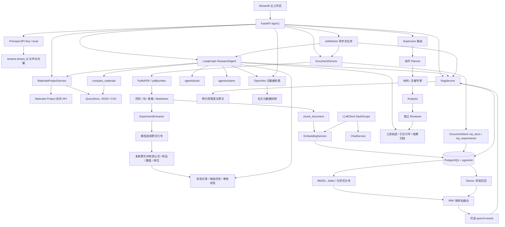

# 当前架构与调用关系

主要函数与边界：

- MaterialsProjectService.search/get_details/get_structure 共用真实 SDK，返回来源与单位。
- DocumentService.ingest 保留原始文件，解析失败保存 failure.json；有库时元数据只写 `DocumentStore`。
- ExperimentExtractor.extract 先选择上下文，再让模型提交块内行号，服务复制原文并校验。
  方法和测量设置保留原文范围，可能包含上下文，不代表已完成科研人工审核。
- chunk_document 在页和证据块内部切分文本，表格保持完整，稳定生成块 ID。
- EmbeddingService.embed 按最多 10 条分批，验证返回顺序、维度、有限值和非零向量。
- VectorStore.replace 在单事务中更新**索引登记 stub**与块；失败回滚；search 使用精确余弦距离。
  全文不在向量表双写（见下方 P0-c）。
- RagService.search 支持 dense / sparse / hybrid；混合模式并行只读召回，按 RRF 融合。
  文本完全重复的证据去重，不把数值不同的相似表格行合并；可选真实通义重排。
  BM25 语料超过配置上限时显式提示截断；重排失败不静默改用其他策略。
- RagService.answer 先检索，再生成逐条引用的答案，拒绝不存在的引用和引文。
- ResearchAgent.run 使用 reason → tools → reason/finish 的 LangGraph 有界循环。
  finish 由模型选择来源和连续行号，程序复制引文；最多 6 次规划、8 次工具调用、1 次引文修复。
- compare_materials 只比较指定查询快照中的候选，保留空值、计算数据类型与筛选局限。
- 生成 / Embedding / Rerank HTTP 经 `LLMClient`；ChatService 为聊天薄封装。

模型选择行号能避免复制时改写原文，不能自动证明每个解释都被证据科学蕴含。

租户隔离（P0-a）：`AUTH_MODE=off` 时固定租户 `local`；`api_key` 模式按 Bearer 映射租户。
文件根为 `data/tenants/{tenant_id}/`；`mp_documents` / `mp_chunks` 含 `tenant_id` 列并过滤。
尚未实现 OIDC、RBAC 或 Postgres RLS；共享部署须开启 `AUTH_MODE=api_key`。
旧版扁平 `data/documents` 等目录需执行 `python -m scripts.migrate_tenant_local`。

异步任务（P0-b）：UI 长任务经 `/api/v1/jobs/*` 入队，`JobWorker` 在 FastAPI lifespan 内启动线程池执行；
状态原子写入 `tenants/{tenant_id}/jobs/{job_id}.json`。同步业务路由仍保留给 CLI/测试。
尚无跨进程抢占或崩溃后自动恢复执行（P3/后续）。

统一持久化（P0-c）：有 `DATABASE_URL` 时，`DocumentStore`（`mp_docs` / `mp_experiments`）为文献与实验元数据 SSOT；
有库时读路径**不**回退磁盘 JSON。PDF 原件仍在租户目录。`VectorStore` 只维护向量索引登记（`mp_documents` stub），
与全文表 `mp_docs` 分工不同。无数据库时回退 `parsed.json` / `experiments.json`。
材料快照与 Agent 任务轨迹仍落租户文件。

可观测与限流（P1-a）：每个请求分配 `X-Request-ID`；审计日志记录 method/path/status/elapsed_ms；
可选 JSON 日志。`RATE_LIMIT_PER_MINUTE=0` 关闭限流；429 错误体含 `request_id`。
高成本前缀含 agent / jobs / knowledge / documents / materials / literature。

Schema（P1-b）：DDL 仅经 lifespan `SCHEMA_AUTO_APPLY`、`scripts.apply_schema` 或 Alembic；
`VectorStore.verify_embedding_config` 只做只读校验。可选 HNSW：`VECTOR_HNSW=true`。

API v1 与模块拆分（P2）：路由前缀 `/api/v1`；DashScope 调用统一 `LLMClient`；
Agent 为 `research`（编排）+ `tools` + `claims` + `collaboration`。

下一步（P3，可选）：评测扩容与人审队列。
